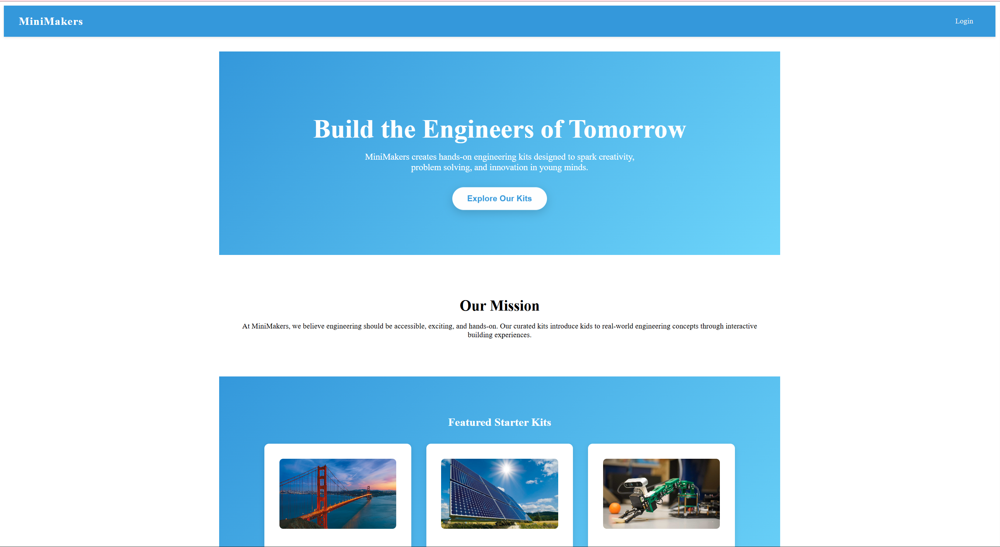
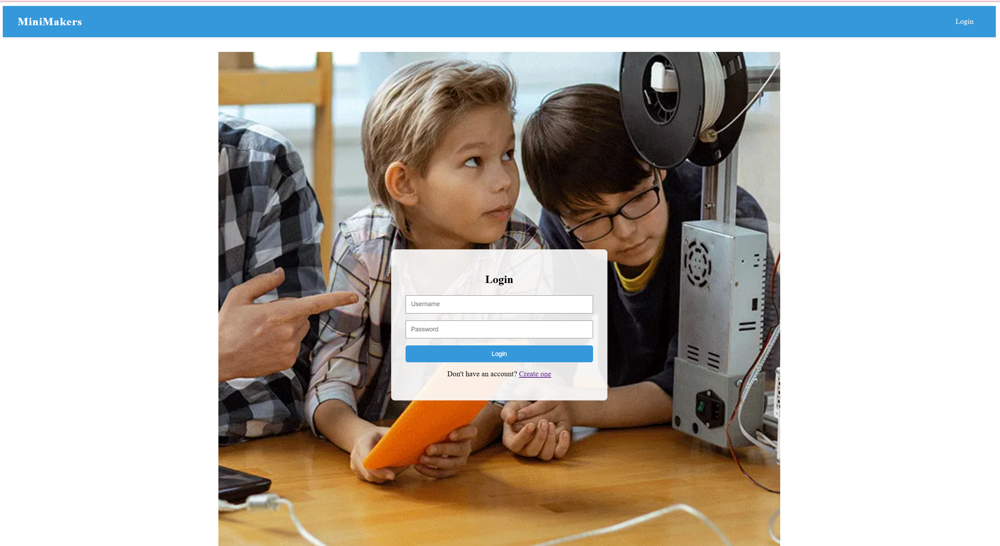
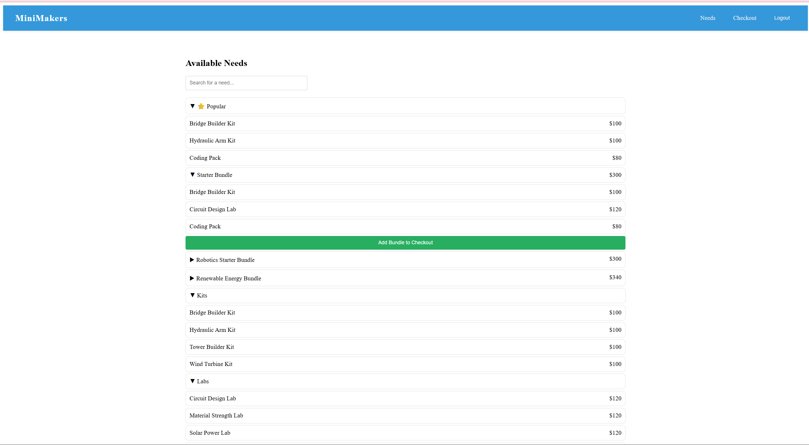
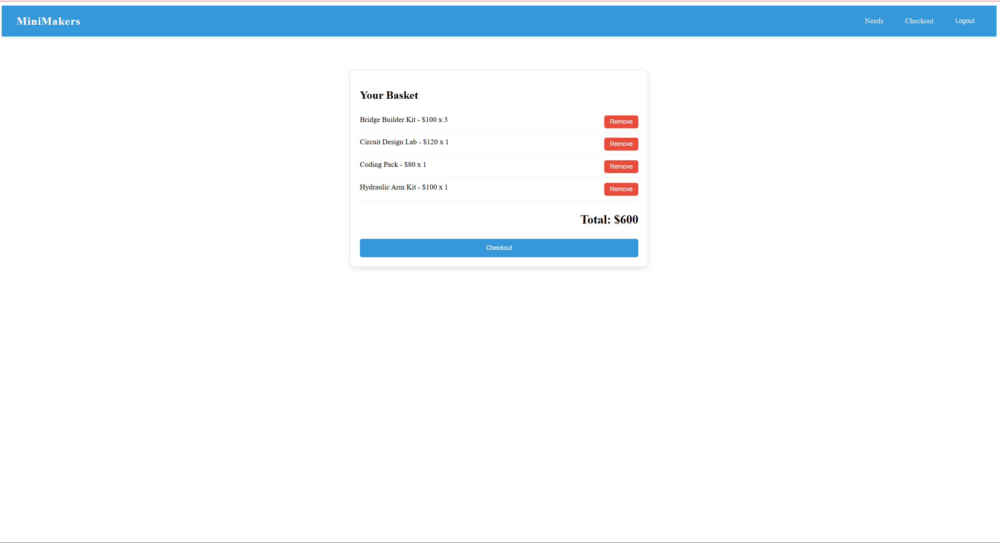

# MiniMakers

**A full-stack e-commerce web application built with Angular and a RESTful API.**

MiniMakers is a full-stack web store where users browse products, manage a cart, and check out, with secure role-based access separating standard shoppers from administrators. Built by a team of four, it pairs an Angular front-end with a Java Spring Boot REST API.

*A collaborative full-stack software engineering project.*

MiniMakers sells engineering kits for children, centered on developing hands-on skills early and giving young learners a head start in engineering.

---

> **Fill in —** Add a screenshot or short GIF of the app here — the storefront and an admin view make a strong pairing. For a repo most reviewers won't run locally, this is the highest-impact thing on the page. Drop the file in a `/screenshots` folder and reference it:

<p align="center">
  
  
</p>

<p align="center">
  
  
</p>

---

## Overview

MiniMakers is a two-tier full-stack application: an Angular single-page front-end (`ufund-ui`) talking to a Java Spring Boot REST API (`ufund-api`). Users can browse the catalog and complete purchases, while a separate administrator tier manages the platform — with access cleanly separated by user privilege.

## Features

- **Product browsing** — Users can explore the catalog through a cohesive, menu-driven interface.
- **Checkout system** — A shopping flow that takes users from browsing to purchase.
- **Role-based access** — Two secure privilege tiers, separating standard-user account management from administrative controls.
- **Cohesive navigation** — Intuitive movement across multiple menus for a smooth end-to-end experience.

## My Contributions

This was a four-person team project. My focus was the front-end and the flows connecting it to the backend:

- Developed the **front-end architecture** in Angular and integrated the backend **RESTful services** that power core features.
- Implemented **secure user and admin privilege tiers**, enabling differentiated access across the platform.
- Designed **intuitive navigation and a smooth user experience** across multiple menus, turning backend functionality into a cohesive, user-facing interface.

## Built With

- **Front-end:** Angular, TypeScript
- **Back-end:** Java, Spring Boot, Maven
- **API:** RESTful

## Getting Started

Running MiniMakers means starting the two halves in separate terminals.

**Prerequisites:** a Java JDK, Maven, and Node.js with npm.

**Back-end (`ufund-api`):**
```bash
cd ufund-api
mvn compile
mvn spring-boot:run
```
The REST API runs at `http://localhost:8080`.

**Front-end (`ufund-ui`):**
```bash
cd ufund-ui
npm install
npm start
```
Open the app at `http://localhost:4200`.

## Team

- **Jordan Landversicht** — Front-end development & API integration
- **Khushi Relan** — Front-end development & API integration
- **Suhani Aggarwal** — Back-end development & documentation
- **Lance Cordova** — Back-end development & architecture

## About This Project

MiniMakers was built by a team of four as a collaborative software engineering project, applying full-stack development, REST API design, and role-based access control in a real, shipped application.
