# PROJECT Design Documentation

## Team Information
* Team name: Team6f
* Team members
  * Lance Cordova
  * Jordan Landversicht
  * Khushi Relan
  * Suhani Aggarwal

## Executive Summary

### Purpose
The purpose of our website MiniMaker is to provide hands-on engineering kits and labs for kids who are intersted in exploring engineering.The primary users of MiniMaker is young student, parents, and educators, who are interested in introducing and exploring engineering concepts through hands-on learning. We aim to make engineering education more accessible, practical, and widespread by allowing users to browse, view, checkout engineering kits in fields like structural engineering, electrical, and robotic's. 

### Glossary and Acronyms
| Term | Definition |
|------|------------|
| SPA | Single Page |
| API | Application Programming Interface|
| DAO | Data Access Object|
| UI | User Interface |
| MVP | Minimum Viable Product |

## Requirements

This section describes the features of the application.

### Definition of MVP
MiniMaker MVP is a working application that supports User Login capabilities, allows viewing a list of kits (Needs), viewing detailed information for each of these kits (type, quanity, cost), and manager functionality to create, update, and delete kits. 

### MVP Features

 The MVP features include:
- User authentication (login/register) with role-based access (helper and manager)
- Viewing all available needs (kits, packs, labs)
- Viewing detailed information for each need (type, quantity, cost)
- Searching for needs using keywords
- Adding needs to a basket and checking out
- Manager functionality to create, update, and delete needs

### Enhancements

 The following enhancements were implemented beyond the MVP:
- Grouping Needs by Type: Needs are organized into categories such as Kits, Packs, and Labs. Each category is displayed as a collapsible section, allowing users to easily browse related items without being overwhelmed by a long list.

- Bundle Feature: Multiple predefined bundles were introduced, including the Starter Bundle, Robotics Starter Bundle, and Renewable Energy Bundle. These bundles group related needs together and allow users to add all items in a bundle to their basket with a single action.

- Most Popular Needs Highlight: Frequently used or important needs are grouped into bundles such as the Starter Bundle to guide users toward commonly selected items and improve decision-making.

- Improved User Experience: Collapsible sections for both bundles and grouped needs improve navigation, and selecting items dynamically displays detailed information while maintaining a clean interface.

## Application Domain

This section describes the application domain.

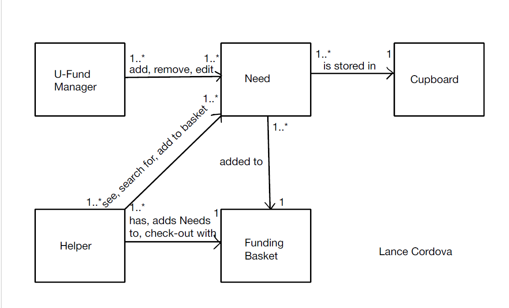

The MiniMaker operates as a domain for education engineeering kits, where each kit is a manageable system entity. Key domain entities are Need's (Engineering Kits), such as Bridge Building Kit, Coding Pack, Material Strength Lab, Mini Robotics Pack, Solar Power Lab, and Tower Building Kit. For each Need you can view the type, quanity, and cost per unit. The User interacts with this system, as they can login as helpers interacting with system data. We also have the Cupboard, which stores our inventory and serves as a system for managing all Needs. Finally you have the Admin, which is a user with system permissions of the inventory. The admin can create new Needs, update existing kits, delete kits, and manage the inventory.

## Architecture and Design

This section describes the application architecture.

### Summary

The following Tiers/Layers diagram shows a high-level view of the webapp's architecture. 
**NOTE**: detailed diagrams are required in later sections of this document.

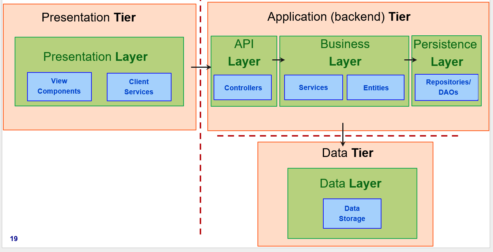

The web application is built using the **Presentation**(frontend), **Application**(backend), **Data** tiered architecture. 

The Presentation (frontend) is a client‑side SPA built with Angular, using HTML, CSS, and TypeScript to deliver the user interface and handle all user interactions.

The Application (backend) tier exposes RESTful APIs, implements business logic, and uses repositories/DAOs to interact with the underlying Data tier for persistence.

The Data contains the mechanisms responsible for storing, retrieving, and managing the application’s data using low‑level storage systems.

Both the Application and Data tiers are implemented using Java and the Spring Framework, with details of their internal components provided below.

### Overview of User Interface

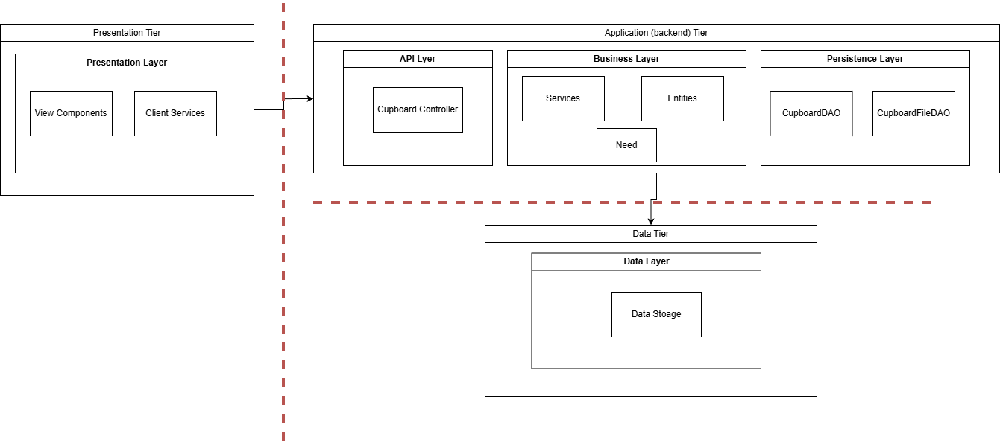

### 
The application features a clean, task-focused user interface designed to guide users through browsing, selecting, and managing items efficiently. The layout appears to follow a straightforward structure with clearly defined sections for navigation and content display. Key pages include a Home Page for entry and overview, a Login page for authentication, a Cupboard page for browsing available items, and a Basket page for reviewing selected items.

The interface likely emphasizes usability with intuitive navigation elements, consistent layout patterns across pages, and clearly labeled actions. Each page serves a distinct purpose, reducing user confusion and supporting a smooth progression through the application.

User Flow and Navigation
From the user’s perspective, the application follows a logical and linear flow:

Home Page (Entry Point)
Users first land on the Home Page, which acts as the main hub. From here, they can navigate to other parts of the application, most importantly the login process or item browsing.

Login Page (Authentication)
If authentication is required, users proceed to the Login page. After successfully logging in, they are redirected back into the main application flow, likely to the Home Page or directly to the Cupboard.

Cupboard Page (Browsing Items)
The Cupboard serves as the core browsing interface where users can view available items. From this page, users can select items they are interested in and add them to their Basket. This page is central to user interaction and decision-making.

Basket Page (Review & Management)
Once items are added, users navigate to the Basket page to review their selections. Here, they can adjust quantities, remove items, or confirm their choices. This page acts as a checkpoint before completing their intended action (e.g., checkout or submission). 

### Presentation Tier

-The Presentation Tier is the part of the system that the user sees and interacts with. It is built using Angular and includes all the visual components such as pages, buttons, and forms.

-In this project, the Presentation Layer contains view components like the Needs page, Basket page, Login page, and Manager Dashboard. These components display information to the user and allow them to perform actions such as searching for needs, adding items to the basket, and viewing details.

-The Client Services in this tier are responsible for sending requests to the backend and receiving data. For example, the NeedService and BasketService communicate with the backend API to fetch and update data.
-Overall, the Presentation Tier focuses on user interaction and displaying data in a clear and organized way.

Sequence Diagram for adding need to checkout
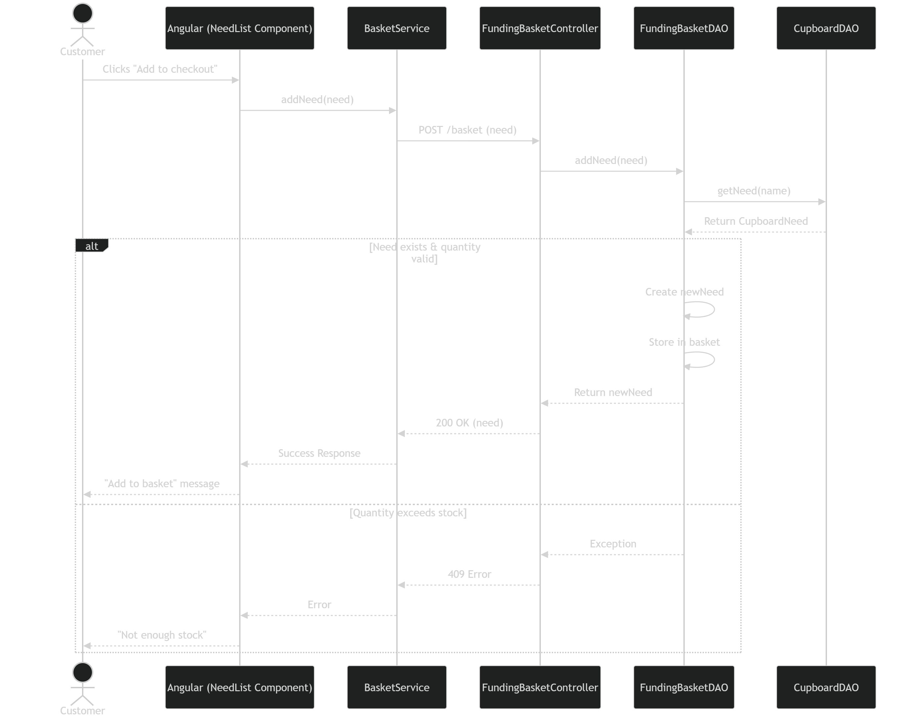

Sequence Diagram for creating a new need
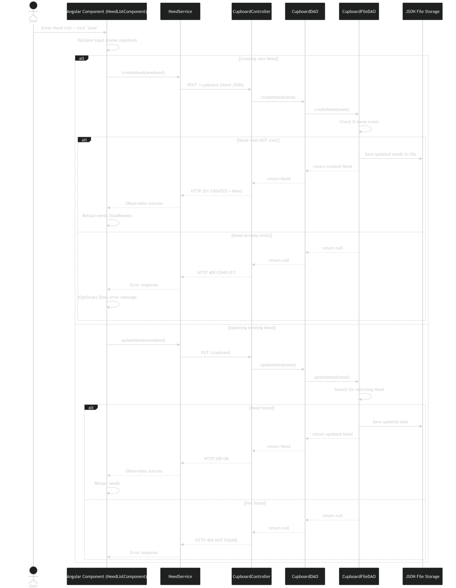

### Application Tier

-The Application Tier handles the main logic of the system. It is built using Java and is divided into different layers such as the API Layer, Business Layer, and Persistence Layer.

-The API Layer includes controllers like the CupboardController, which receives requests from the frontend and sends responses back.

-The Business Layer contains services and entities. The services handle the main logic, such as grouping needs, processing bundles, and managing basket actions. The Need entity represents the data structure used in the system.

-The Persistence Layer is responsible for storing and retrieving data. It uses classes like CupboardDAO and CupboardFileDAO to access and manage the stored data.

-This tier acts as the bridge between the user interface and the data storage, making sure everything works correctly.

#### API Layer

-The API Layer handles communication between the frontend and backend. It includes the CupboardController, which processes requests such as retrieving needs, searching, and updating inventory. It receives requests from the frontend and returns the appropriate responses. 

1. createNeed -> add's a new kit to the inventory
2. getNeed -> retrieves information about a specific kit
3. deleteNeed -> removes a kit from the inventory
4. updateNeed -> modifies information of existing kit
5. searchNeeds -> searches need based on keyword
6. getAllNeeds -> return's a complete list of kits
7. createStarterPack() -> creates a bundle for checkout

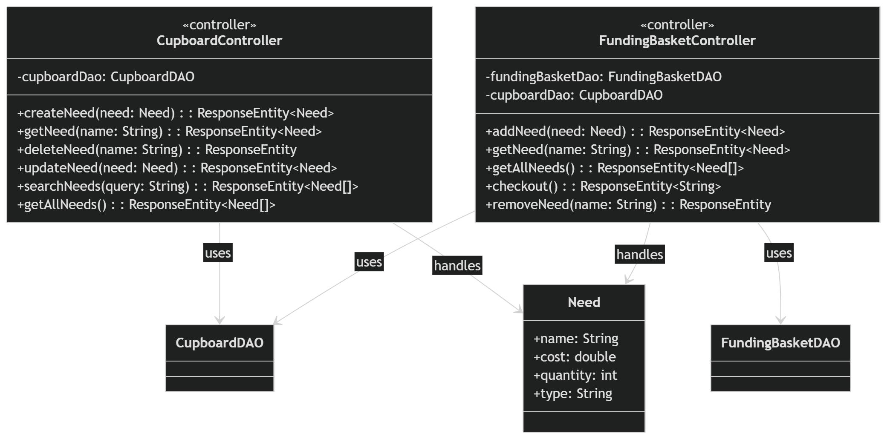

#### Business Layer

-The Business Layer contains the main logic of the system. It processes operations such as grouping needs, managing bundles, handling basket actions, and applying business rules.

-This layer includes services and entities such as the Need class, which represents the core data structure. It ensures that all operations follow the correct logic before interacting with the data layer.

Need
1. getName
2. getCost
3. getQuantity
4. getType
5. setName
6. setCost
7. setQuantity
8. setType
Starter Pack
1. getPackName()
2. getKitList()
3. calculateTotalCost()

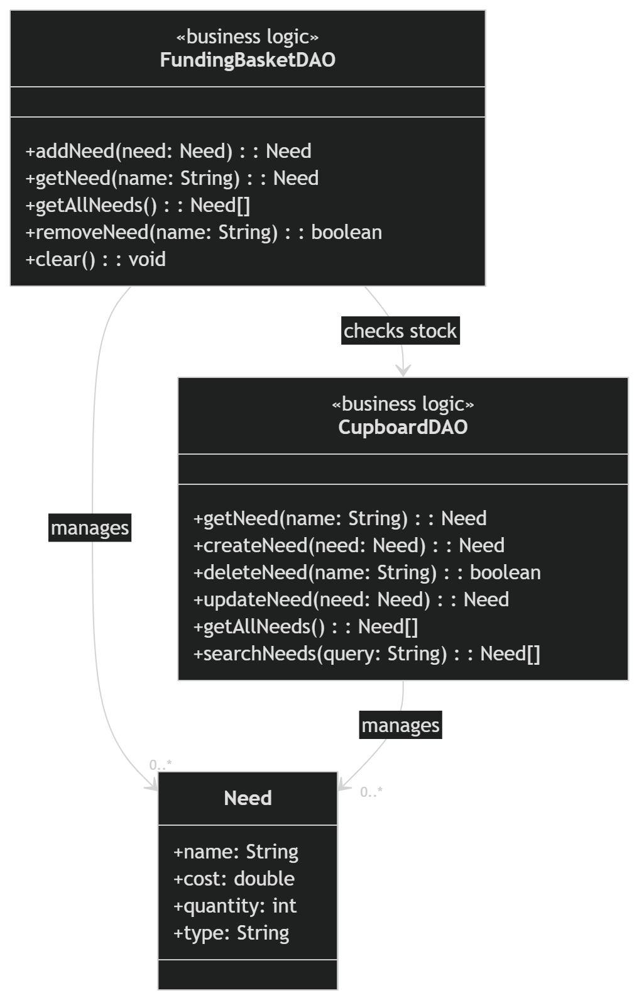

#### Persistence Layer

-The Persistence Layer is responsible for storing and retrieving data. It includes DAO classes such as CupboardDAO and CupboardFileDAO.

-These classes handle operations like loading, saving, updating, and deleting needs from storage, ensuring data consistency across the system.

1. getNeed -> retrieve a kit from storage by name 
2. createNeed -> save a new kit
3. deleteNeed -> removes a kit
4. getAllNeeds -> fitches and return's all kits
5. searchNeeds -> search kit by keyword
6. updateNeed -> update kit information
7. load -> load inventory data from persistent storage 
8. save -> save inventory data to persistent storage.
9. createStarterPack -> persist a bundle kit pack

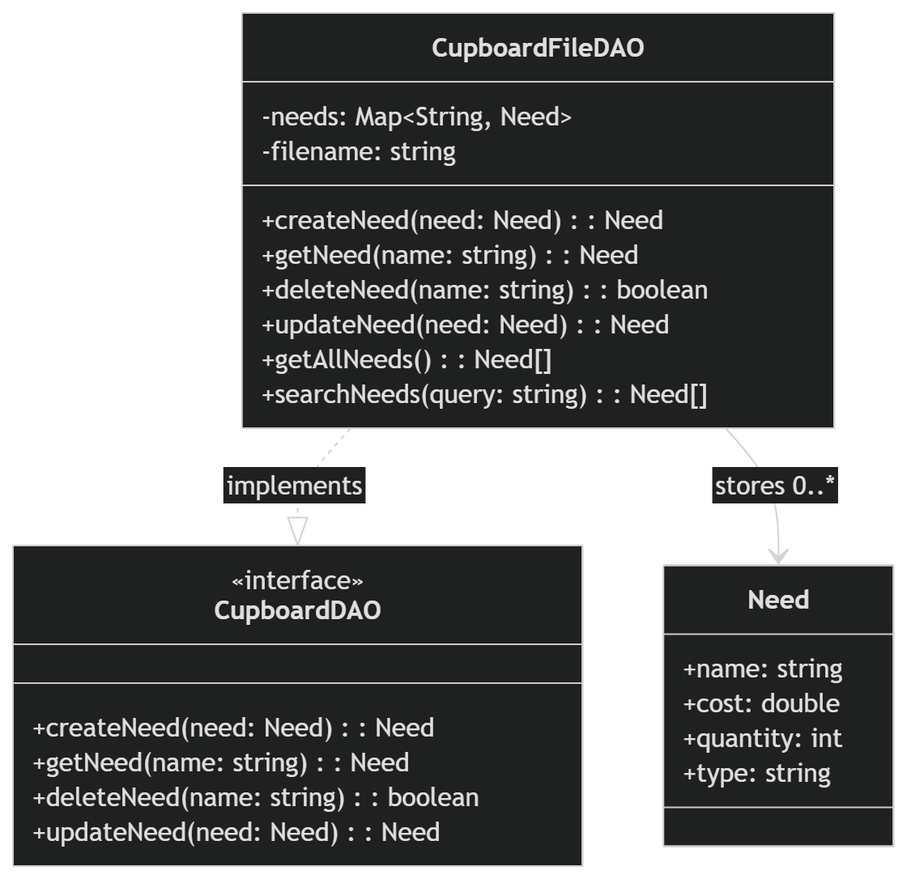

### Data Tier

-The Data Tier is responsible for storing all the data used in the system. This includes information about needs, such as their name, type, cost, and quantity.

-The data is stored in a structured format and is accessed through the data layer. This layer ensures that data is saved, updated, and retrieved correctly when requested by the Application Tier.

-The Data Storage component holds all the information and supports operations like adding new needs, updating existing ones, and removing items.

-Overall, the Data Tier ensures that all data is organized, consistent, and available when needed.

## OO Design Principles

-Single Responsibility Principle (SRP): A class should have only one reason to change, meaning it should focus on a single, well-defined task.

1. Controllers such as CupboardController and FundingBasketController are responsible only for handling HTTP requests and returning appropriate responses (e.g., status codes like 200, 409, etc.).
2. DAO classes (CupboardDAO, FundingBasketDAO, CupboardFileDAO) are responsible for data management and business-related operations such as creating, updating, and validating needs.
3. The Need model strictly represents the data structure and does not contain business logic.
On the frontend, NeedListComponent handles UI interaction, while NeedService is responsible for API communication.

-Open-Closed Principle (OCP): Software entities (classes, modules) should be open for extension but closed for modification, allowing behavior to change without altering source code.

1. The CupboardDAO interface defines a contract for data operations.
2. CupboardFileDAO implements this interface, but you could easily introduce a new class (e.g., CupboardDatabaseDAO) without modifying the controller or business logic.

-Low Coupling: reducing dependencies between classes, ensuring changes to one module have minimal impact on others.

1. Controllers depend on interfaces (CupboardDAO) rather than concrete implementations, reducing direct dependencies.
2. The Angular frontend communicates with the backend via HTTP requests, meaning the frontend and backend are loosely coupled and can evolve independently.
3. FundingBasketDAO interacts with CupboardDAO rather than directly manipulating storage, further decoupling logic from persistence.

-Information Expert: assigns responsibility for a task to the class that holds the information necessary to fulfill it.

1. FundingBasketDAO is responsible for validating whether a need can be added to the basket because it has access to both:
Basket contents
2. Cupboard data (via CupboardDAO)
3. CupboardFileDAO is responsible for saving and retrieving needs because it manages the in-memory map and file storage.
The Need class holds all relevant attributes (name, cost, quantity, type), making it the natural data carrier for operations.

-Dependency inversion/injection: used to achieve loose coupling, enhance modularity, and improve testability.

1. Controllers receive dependencies through their constructors: public CupboardController(CupboardDAO cupboardDao)
2. This means controllers depend on the abstraction (CupboardDAO), not the concrete implementation (CupboardFileDAO).

-Controller: responsible for managing system events, acting as an intermediary between models and views, often implemented to handle specific use cases.(CupboardController class)

1. CupboardController and FundingBasketController act as intermediaries between the frontend and backend logic.
They: Receive HTTP requests (POST, GET, DELETE, etc.), Delegate work to DAO classes, Return appropriate HTTP responses

## Static Code Analysis/Future Design Improvements

Static code analysis identified several areas for improvement:
- Code Duplication: Some logic (such as grouping and filtering) could be refactored into reusable helper functions to reduce duplication.
- Use of Any Type: Some variables were initially typed as 'any', which reduces type safety. These were improved by introducing proper interfaces (e.g., Bundle interface).
- UI Responsiveness: Some components required manual change detection, which could be improved with better state management.
- Error Handling: Error handling in HTTP requests can be expanded to provide more detailed user feedback.

Future refactoring and other design improvements: 
- Refactoring frontend logic into smaller reusable components
- Improving UI styling and responsiveness
- Adding more advanced filtering and sorting options
- Enhancing bundle customization (user-created bundles)

## Testing

### Acceptance Testing

-Most user stories have passed their acceptance criteria, including login, viewing needs, searching, grouping, and bundle functionality.
-Some minor UI issues were identified during testing, such as search behavior with bundles and group collapsing behavior, which were resolved.
-Overall, the system meets the functional requirements of the MVP and enhancements, with no major blocking issues remaining.

### Unit Testing and Code Coverage

-The team implemented unit tests for key components such as NeedListComponent, BasketComponent, LoginComponent, and RegisterComponent using Angular testing utilities.
-The testing strategy focused on verifying component creation, basic functionality, and interaction with services.
-Code coverage was measured using Angular's built-in testing tools. The team aimed for moderate coverage to ensure critical functionality was tested while maintaining development efficiency.
-Future improvements include increasing test coverage, adding more edge case testing, and improving service-level tests.

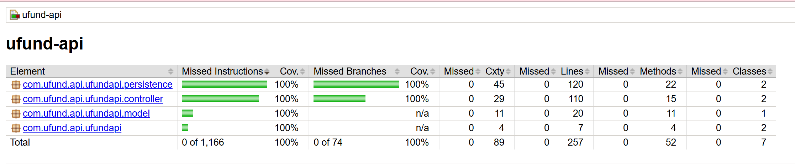
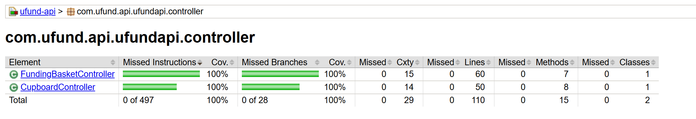
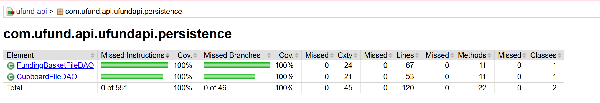

## Ongoing Rationale
